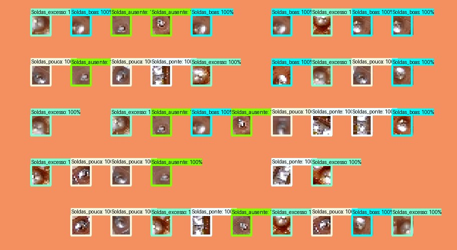
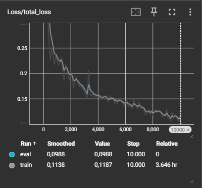
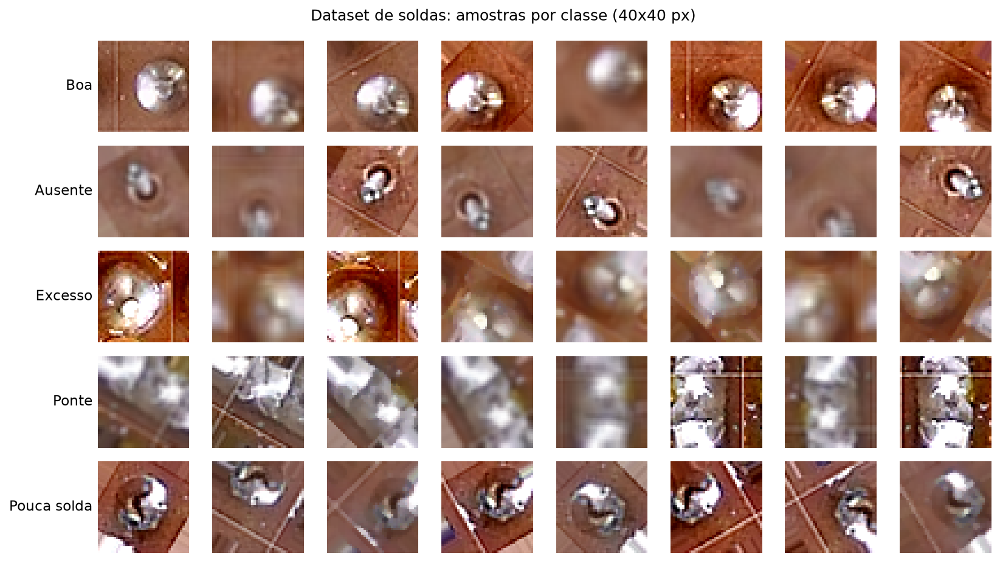
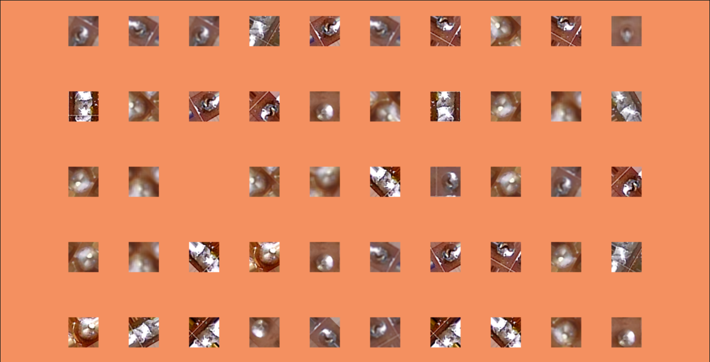
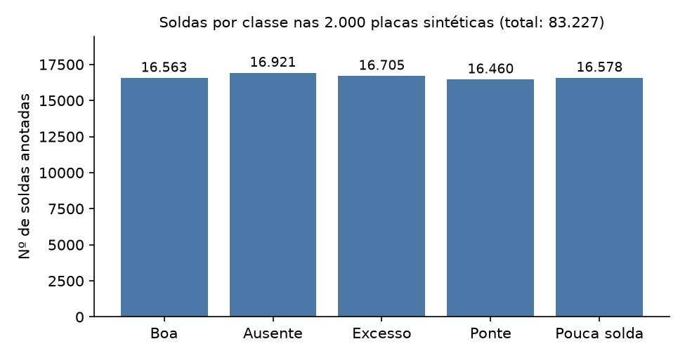

# Detecção de falhas de solda em PCBs com dados sintéticos e SSD

Iniciação Científica (PROIIC/CNPq, UESC, 09/2023 – 08/2024): uma ferramenta em Python que **gera placas de circuito
impresso sintéticas, já anotadas**, a partir de recortes reais de soldas, e um pipeline que **treina um detector SSD**
para localizar e classificar cinco tipos de solda. A ideia central é *data augmentation* por composição de imagens: em vez de
anotar placas reais à mão, o gerador monta milhares de placas com a proporção de defeitos que se quiser.

<p align="center">
  <br>
  <em>Saída do modelo sobre uma placa sintética: cada solda recebe caixa, classe e score.</em>
</p>

## Resultados

Modelo `ssd_mobilenet_v2_fpnlite_320x320` (TensorFlow Object Detection API), ajustado por 10.000 passos em 1.900 placas sintéticas
(2.000 geradas; o restante reservado para avaliação). Métricas no estilo COCO:

| Métrica                      | Valor   |
|------------------------------|---------|
| AP @ IoU 0,50:0,95           | 96,1 %  |
| AP @ IoU 0,50                | 100 %   |
| AP @ IoU 0,75                | 100 %   |
| AR @ 100 detecções           | 97,7 %  |
| Loss total (treino / eval)   | 0,119 / 0,099 |

<p align="center">
  <br>
  <em>Loss total ao longo dos 10.000 passos (≈ 3,6 h de treino).</em>
</p>


## Como funciona

1. **Dataset de soldas** ([`data/raw`](data/README.md)): 7.920 recortes 40×40 px em 5 classes balanceadas (1.584 cada).
2. **Gerador** ([`src/generate_boards.py`](src/generate_boards.py)): monta uma placa em grade (padrão: 10 colunas × 5 linhas = 940×500 px),
   sorteia a classe de cada posição segundo proporções definidas pelo usuário (ou aleatórias), cola o recorte e grava, para cada placa,
   a imagem, a anotação **YOLO** (`.txt`), a anotação **Pascal VOC** (`.xml`, usada pelo SSD) e um relatório de contagem por classe.
3. **Treinamento/avaliação** ([`notebooks/training_ssd.ipynb`](notebooks/training_ssd.ipynb)): TFRecords → fine-tuning do SSD MobileNetV2 FPN-Lite
   pré-treinado no COCO → avaliação no TensorBoard → inferência em imagens e em webcam.

<p align="center">
  <br>
  <em>As cinco classes: solda boa, ausente, em excesso, com ponte e com pouca solda.</em>
</p>

<p align="center">
  <br>
  <em>Placa sintética gerada pela ferramenta (posições sem recorte são "espaço em branco", sem anotação).</em>
</p>

<p align="center">
  <br>
  <em>Soldas anotadas por classe nas 2.000 placas geradas (≈ 83 mil no total, bem balanceadas).</em>
</p>

## Estrutura do repositório

```
.
├── src/
│   └── generate_boards.py       # gerador de placas sintéticas + anotações
├── notebooks/
│   └── training_ssd.ipynb       # treino, avaliação e inferência do SSD
├── samples/                     # 3 placas de exemplo com anotações YOLO, VOC e relatório
├── docs/images/                 # figuras usadas neste README (extraídas do relatório final)
├── data/                        # dataset e placas geradas (ignorados pelo Git; ver data/README.md)
├── requirements.txt             # dependências do gerador
├── requirements-training.txt    # dependências do treinamento (Python ≤ 3.11)
└── .gitignore
```

## Como reproduzir

### 1. Gerar placas sintéticas

Coloque o dataset de soldas em `data/raw/Dataset_Soldas/` (ver [`data/README.md`](data/README.md)) e execute:

```bash
python -m venv .venv
.venv\Scripts\activate          # Linux/macOS: source .venv/bin/activate
pip install -r requirements.txt
python src/generate_boards.py
```

O script é interativo: escolha `1` para uma placa com proporções definidas por você ou `2` para N placas com proporções aleatórias, e informe
o número de colunas e linhas. Para reproduzir o experimento: opção `2`, 10 colunas, 5 linhas, 2000 placas. A saída vai para `data/synthetic/`.

### 2. Treinar e avaliar o SSD

```bash
pip install -r requirements-training.txt     # use Python 3.9–3.11
jupyter notebook notebooks/training_ssd.ipynb
```

O notebook cria a pasta `Tensorflow/` onde for executado, clona a TF Object Detection API e baixa o modelo pré-treinado. Antes de gerar os
TFRecords é preciso separar manualmente imagens + XML (`data/synthetic/images` e `annotations/pascal_voc`) em `Tensorflow/workspace/images/train` e `.../test`.


## Créditos

- **Autor:** Murilo Patricio Maia · **Orientador:** Esbel Tomás Valero Orellana · Universidade Estadual de Santa Cruz (UESC), Ilhéus-BA.
- Dataset de soldas: Mar, Yarlagadda & Fookes (2011), *Design and development of automatic visual inspection system for PCB manufacturing*,
  Robotics and Computer-Integrated Manufacturing, 27(5); e Cabral Júnior, P. C. (2022), dissertação de mestrado, UESC.
- Modelo: SSD (Liu et al., ECCV 2016) via [TensorFlow Object Detection API](https://github.com/tensorflow/models).
